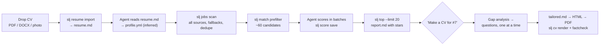

# SriLankanJobs Agent v2 — PRD

**Drop your CV into your AI coding agent, get the 20 best-matching Sri Lankan jobs with star ratings, then get a tailored CV for any of them.**

Nov 15, 2026 (rev. 2: no backend, open source, ThreatHire-based scraper, browser tier, watermark, "more jobs") · Shaqeeq Khan · Status: draft for build in Claude Code
Supersedes the scope of the original v1 PRD (Oct 20, 2026, not published).

---

## 1. TL;DR

SriLankanJobs Agent v2 is a folder people open in the AI tool they already pay for (Claude Code, Codex with a ChatGPT plan, Gemini CLI, Cursor, VS Code Copilot, Windsurf, OpenCode). It does three things:

1. **Read the CV.** The person drops a PDF, Word file or photo of their CV. A script converts it to Markdown. From then on, everything works on Markdown.
2. **Find and rate jobs.** Scrapers pull current listings from Sri Lankan job sites. The agent shows the **top 20 matches, always 20**, each rated **1 to 5 stars** on an absolute scale with a short reason.
3. **Tailor a CV.** The person says "make me a CV for #7". The agent asks the questions it needs, writes a tailored CV in Markdown, renders it to HTML, then prints a PDF.

The person's AI subscription supplies the intelligence. We supply scrapers, scoring rules, templates and a PDF renderer.

**No backend, open source.** It's an MIT-licensed GitHub repo that runs entirely on the person's machine. There is no server, no central job feed, no accounts, no API keys and no telemetry. The scrapers run locally, the agent runs locally, and the CVs stay in `user/`. The only network traffic goes to the job sites and to the person's own AI provider.

**Not in v1:** applying, sending email, inbox tracking, portal form filling, the Electron app and the web UI. These were in the October PRD. They wait until v1 shows that people come back for the top 20.

---

## 2. What changes from the October build

| Area | Oct 2026 PRD / Phase 0 code | v2 decision |
| --- | --- | --- |
| Product surface | Agent folder **plus** Electron desktop app and local web app | Agent folder only. Delete `app/` and `install/` from the plan |
| Where jobs come from | A central srilankanjobs.lk feed (`slj jobs fetch`), running a scraper that **is not in this repo** | **Local scrapers in this repo** (`slj jobs scan`), built on ThreatHire's scraper design (§7) and ported to TypeScript, each with a fallback ladder. **No central feed:** there is no backend. Remove the feed client, `SLJ_INSTALL_KEY` and `docs/feed-api.md` |
| robots.txt | Checked on every fetch; topjobs.lk set to `no_automated_fetch` | **Not consulted** (owner's decision, 15 Nov 2026). Pacing, caching and the human-check handoff stay |
| Onboarding | 15–25 minute profile interview before any search | **Zero questions to get the first top 20.** Infer from the CV, state assumptions, and let the person correct them. Ask questions only when tailoring a CV |
| Scoring | 1–5, threshold 3.5, shortlist capped at 10 | **Always the top 20**, 1–5 stars on an absolute scale with no threshold |
| CV generation | Templates and fact gate planned, files are 1-line stubs | Markdown → HTML template → PDF, using a vendored, adapted resume skill (§8) |
| Apply / track / auto-send | Phases 2–3 | Out of scope |
| Reused as-is | — | Command registry, CLI + MCP parity, SQLite store and dedupe, normalise, extract, `config/sources.yml`, `AGENTS.md` + thin wrappers, `modes/_shared.md` (Sri Lankan conventions and scam signals) |

**Finding to note:** the Phase 0 code has **no scrapers**. It is a client for a feed at `srilankanjobs.lk/api/v1/jobs`, which won't exist under the no-backend decision. The scrapers are built in M1, porting ThreatHire's architecture (Python) into this repo's TypeScript. The browser tier is already written: `src/sources/browser.ts` (§7.4).

---

## 3. Users and jobs to be done

| Persona | Example | What they need from v1 |
| --- | --- | --- |
| Tech-savvy seeker | SE, data or marketing grad in Colombo who already uses Claude Code, Codex or Cursor | One command to see which current jobs fit, plus a sharp tailored CV |
| Helper | Older sibling, university career unit, bootcamp mentor | Run it for several people: one `user/` folder per person (`SLJ_HOME`) |
| Non-technical seeker | Not a v1 user | Reached later through a hosted version or a helper |

**Jobs to be done**

- "Here's my CV. What's out there for me right now?"
- "Be honest: how good is my CV for these roles?"
- "I want job #7. Make my CV fit it without lying."

---

## 4. Goals, metrics, non-goals

**Goals**

1. A CV dropped in → top-20 report on screen in **under 5 minutes** on a home connection (scan plus scoring).
2. Stars people agree with: in a 30-job hand-labelled set, the agent's stars are **within ±1 of a human recruiter's** for at least 85% of jobs.
3. Tailored CV PDFs with **zero invented facts**. The fact check passes on 50 test CVs.
4. Works the same in **at least 4 agents**: Claude Code, Codex, Gemini CLI, and Cursor or Copilot.
5. Scrapers that keep working. Every source has a fallback, and `slj sources doctor` tells you which sources are failing and why.

**Metrics after launch.** There is no telemetry, so the signals are public ones:
- GitHub stars, forks and clones;
- issues filed with `slj sources doctor` output (which source broke, and how);
- visits to srilankanjobs.lk from the CV watermark (§5.5) and the README.

A local, never-uploaded `user/stats.json` (number of scans, top-20 reports and CVs made) lets a person paste their own numbers into an issue if they want to.

**Non-goals (v1):** applying or submitting, sending email, reading the inbox, LinkedIn or Facebook scraping, overseas or agency jobs, Sinhala or Tamil UI, any backend or hosted service, and a GUI.

---

## 5. User flow



### 5.1 Import the CV

- The person drags a file into `user/inbox/`, or into the chat, or gives a path. Accepted: `.pdf`, `.docx`, `.md`, `.txt`, `.png`, `.jpg`.
- `slj resume import <file>` converts it deterministically:
  - PDF with a text layer → Markdown (headings, lists and links kept). Library is the builder's choice, e.g. `unpdf` / pdf.js in Node, or `pymupdf4llm` when Python is present.
  - DOCX → Markdown (`mammoth` → HTML → Markdown).
  - Scanned PDF or photo → the script outputs page images and returns `NEEDS_VISION`. The agent reads the images with its own vision and writes the Markdown. Every agent on the list can read images.
- The agent then cleans the conversion into `user/resume.md`, which becomes the source of truth. It shows the person a short diff of anything it fixed (merged lines, broken bullets) and **never adds content** at this step.
- The agent writes `user/profile.yml` with **inferred** fields, each marked `inferred: true`: target titles (up to 3, plus adjacent ones), seniority, years of experience, core skills, location, work-mode preference, and whether the CV style is modern or traditional.
- It says something like: *"I've assumed you're looking for Junior Data Analyst or BI roles in Colombo, hybrid OK. Say 'change' to fix any of that. Scanning now."* It does not wait for an answer.

### 5.2 Scan jobs

`slj jobs scan [--sources a,b] [--since 14d]` runs every enabled source in `config/sources.yml` through the fallback ladder (§7), normalises jobs into the existing `JobFields` schema, dedupes them, and drops jobs whose closing date has passed. It returns per-source counts and per-source status (`ok`, `degraded:tier3`, `blocked`, `stale-cache`).

### 5.3 Match and rate

**Stage 1, prefilter (code, no LLM).** `slj match prefilter --limit 60` ranks open jobs by:
- similarity between the job title and the target titles (including the adjacent titles);
- overlap between the CV's skills and the job description (BM25, e.g. `minisearch`);
- location fit;
- recency.

This keeps token cost bounded no matter how many jobs the scan finds.

**Stage 2, LLM scoring (the agent).** The agent scores candidates in batches of 10. Each job description is trimmed to its requirements section, about 1,500 characters. The rubric lives in `modes/score.md` and is weighted to 100 points:

| Dimension | Weight | Notes |
| --- | --- | --- |
| Role / title fit | 25 | Is this the kind of role the CV points to? |
| Must-have requirements met | 30 | Each requirement is marked met / partial / missing, with the JD phrase quoted |
| Seniority / years | 15 | Penalise both under-qualified and clearly over-qualified |
| Education and qualifications | 10 | Degree, CIMA/ACCA/CA/AAT/BCS/NVQ, O/L and A/L where the ad asks |
| Location / work mode | 10 | Commute or relocation, WFH, shifts |
| Domain / industry | 10 | Banking, apparel, BPO, telco, etc. |

- **Caps:** a missing mandatory qualification or licence caps the job at 2 stars. A scam signal from `_shared.md` caps it at 1 star and shows a ⚠️.
- **Stars from points:** 85+ = ★★★★★, 70–84 = ★★★★, 55–69 = ★★★, 40–54 = ★★, under 40 = ★.
- **Stars are absolute, not relative.** We always show 20 jobs, but a weak CV against a thin market will show mostly ★★. That is the honesty the person asked for.
- Each score saves its `points`, `stars`, `matched[]`, `gaps[]`, a `why` line of 20 words or fewer, `rubric_version`, and the model name. Saved through `slj score save`.
- **Caching:** scores are keyed by `(resume_hash, job_hash, rubric_version)`. Re-running the same day re-scores only new jobs.
- **Parallelism:** Claude Code may fan out to subagents, one per batch. Every other agent scores batches one after another. The result has to be the same either way.

**Always 20.** If fewer than 20 open jobs survive, the agent widens the search before it reports fewer: adjacent titles first, then a longer `--since` window, then nearby districts. If the pool is still short, it shows what exists and says how many there were.

### 5.4 The top-20 report

`slj top --limit 20` writes `user/reports/<date>-top20.md`, and the agent shows it in chat:

```markdown
## Your top 20 — 15 Nov 2026 (scanned 1,284 open jobs from 7 sites)

**How your CV reads to this market:** strong on SQL and Power BI; the gap that costs you most is
no cloud (AWS/Azure) in 9 of the top 20. Fixing that one line could lift 6 jobs by a star.

| # | Fit | Role | Company | Location | Closes | Apply via | Job post | Why it was picked |
|---|-----|------|---------|----------|--------|-----------|----------|-------------------|
| 1 | ★★★★★ | Data Analyst | Example Telco PLC | Colombo 02 | 22 Nov | xpress.jobs | [View ad](https://…) | 5/5 must-haves, SQL + Power BI named |
| 2 | ★★★★☆ | BI Developer | Example IT (Pvt) Ltd | Colombo | 30 Nov | Workday | [View ad](https://…) | Meets all but SSIS (partial) |
| … |
| 20 | ★★☆☆☆ | Analytics Exec | … | Kandy | 25 Nov | ikman.lk | [View ad](https://…) | Location outside range; 2 gaps |

Say **"CV for #2"** to get a tailored CV, **"why #5?"** for the full breakdown, or **"more jobs"** for the next 20.
```

### 5.4a More jobs on request

The person can say "more jobs", "show 20 more", "next 20" or "/slj more" at any time. The agent fetches the next page in rank order, numbered on from the last report (#21–#40, then #41–#60, and so on), so "CV for #34" keeps working. Every step below is automatic:

1. **Already scored:** `slj top --offset 20 --limit 20` from the scores in hand. Costs no LLM calls.
2. **Score deeper:** when the scored pool runs out, `slj match prefilter --offset 60 --limit 60` and score that batch the usual way.
3. **Widen:** when the prefiltered pool runs out, widen in this order and say which widening happened:
   - adjacent titles;
   - a longer `--since` window (14 → 30 → 60 days);
   - nearby districts and remote jobs;
   - **slow sources** that only run on request (browser-tier sites, ATS employer boards).
4. **Exhausted:** say how many open jobs exist in total and that all of them have been shown.

Variants the agent understands: "more jobs in Kandy", "more but only remote", "more like #3". Each one re-ranks the remaining pool with that filter or anchor; it doesn't re-score.

Each page is appended to the day's report file (`user/reports/<date>-top20.md` gets `## #21–#40` and so on), and the report's header gives the running total ("showing 40 of 312 scored, 1,284 open").

- The section titled **"How your CV reads to this market"** covers the "your resume might not be good" case. It names the 1–3 gaps that recur most across the top 20, plus what fixing each one would unlock. It never suggests claiming something the person hasn't done.
- `why #N` prints the full rubric table for that job: each requirement, the quoted JD phrase, and met, partial or missing.

### 5.5 Tailored CV for a job

Trigger: "CV for #7", "make a resume for the Dialog job", or `/slj cv 7` in Claude Code.

1. **Gap analysis.** Compare `resume.md` with the job's requirements: strong / partial / missing / unknown.
2. **Questions.** Ask one at a time and branch on the answer (the pattern from the vendored skill, §8). Ask only what would change the page: metrics, scale, ownership, tools actually used, missing O/L or A/L details, referees for traditional CVs. Stop after about 8 questions or when the person says "enough". Every answer goes into `user/facts.yml` with `source: interview` after the person confirms it.
3. **Write** `user/output/<job-id>/cv.md` from `resume.md` + `facts.yml` only. Choose the style: **modern ATS** (1–2 pages) or **traditional Sri Lankan** (personal details, O/L and A/L, two non-related referees), based on job type. The person can override.
4. **Review pass.** Critique the draft as the hiring manager would, against this job description. In Claude Code this is a subagent. Elsewhere it runs in the same context and is labelled as such.
5. **Fact check.** `slj factcheck --job <id>` fails on any employer, title, date, number, qualification or tool that isn't in `resume.md` or `facts.yml`. A failed check means fix and re-run, never skip.
6. **Render.** `slj cv render --job <id> --style modern|traditional` converts Markdown to HTML using `templates/cv-*.html`, then prints a PDF, A4 by default. It saves `Firstname_Lastname_<Role>.pdf` and `.html`, and reports the page count. The PDF carries the watermark below.

   **Watermark.** The footer of every page shows *"Resume designed by srilankanjobs.lk"*.
   - **Size and look:** 6 pt by default, configurable down to 4 pt (`cv.watermark.size_pt` in `settings.yml`, 4–6). Grey `#9aa0a6`, centred, inside the bottom margin, so it never pushes content onto another page.
   - **How it's rendered:** Playwright `page.pdf({ displayHeaderFooter: true, footerTemplate, headerTemplate: '<span></span>' })`. The empty `headerTemplate` is required. Without it Chrome prints the date and page title at the top, and the default footer prints the local `file://` path, which leaks the person's home folder onto a document sent to employers (the same trap resume-optimizer guards against with `--no-pdf-header-footer`).
   - **Fallback:** when the PDF is printed from a browser by hand (no Chrome found), the watermark is a final `<p class="slj-mark">` at the end of the content, at the same size. In that case it appears at the end, not in a page footer.
   - **Checks:** `factcheck` and the ATS keyword check skip the watermark line. The text-layer check confirms it is present.
   - **Tradeoffs:**
     - 4 pt is below what most printers reproduce cleanly, and some PDF-to-text parsers drop text under 5 pt. 6 pt is the smallest size that reliably survives printing and parsing, which is why it is the default.
     - Some candidates may not want branding on their CV. The code is open source, so `cv.watermark.enabled: false` exists, and the README says so plainly. Hiding the switch would only invite forks that strip it out.
7. **ATS check.** The PDF's text layer must contain the name, email, phone and the job's must-have keywords that the CV legitimately has. Reported as a table.
8. **Deliver.** The agent prints the file paths, a "changes made" list, and up to 5 questions that would make the CV stronger.

Optional, as a stretch for v1: a cover note of 150 words or fewer, saved as `cover.md`, following the ad's subject-line instruction. It is never sent.

---

## 6. Agent-agnostic design

**Brains in Markdown, hands in code.** This is unchanged from Phase 0.

| Tool | How it finds the instructions | How the person invokes it |
| --- | --- | --- |
| Claude Code (Claude subscription), **primary test target: the Claude Code extension in Cursor** | `CLAUDE.md` → `@AGENTS.md`; skill at `.claude/skills/slj/` (symlink to `.agents/skills/slj/`); slash commands `/slj jobs`, `/slj cv <n>` | Slash command or plain English |
| Codex CLI / Codex IDE extension (ChatGPT plan) | `AGENTS.md` natively; `.agents/skills/slj/SKILL.md` | Plain English |
| Gemini CLI | `GEMINI.md` → `AGENTS.md` | Plain English |
| Cursor | `AGENTS.md` plus a thin `.cursor/rules/slj.mdc` pointing to it | Plain English in Agent mode |
| VS Code + Copilot agent mode | `AGENTS.md` plus `.github/copilot-instructions.md` pointer | Plain English |
| Windsurf, OpenCode, others | `AGENTS.md` (+ existing `OPENCODE.md`) | Plain English |

Rules:
- Every capability is a `slj` command with `--json`, mirrored as an MCP tool from the single registry. The CLI is primary, because IDE agents run shell commands more reliably than they configure MCP.
- **No step may need vendor-only features.** Subagents, slash commands and hooks are optional speed-ups for Claude Code. The plain path has to give the same result.
- Long steps (`jobs scan`) are a single command that finishes in under 3 minutes and prints progress, because some IDE agents kill long-running terminals. Browser-tier sources that may wait on a person can run as their own step (`slj jobs scan --sources topjobs`), so one human check doesn't hold up the whole scan.
- When `user/browser-status.json` says `waiting_for_human`, the agent tells the person in chat to look for the Chrome window, along with the cons from §7.4. It doesn't wait silently.
- Claude Code (and the other CLIs listed) can be run headless (`claude -p "find jobs for user/inbox/cv.pdf"`). This is how the "fast scan" end-to-end test runs in CI.

**Folder layout (v2)**

```
srilankanjobs/
├── AGENTS.md  CLAUDE.md  CODEX.md  GEMINI.md  OPENCODE.md
├── .agents/skills/slj/SKILL.md          router skill (shared)
├── .agents/skills/resume-tailor/        vendored + adapted resume skill (§8), MIT notice kept
├── .claude/skills/ -> ../.agents/skills/ ; .claude/commands/slj.md
├── .cursor/rules/slj.mdc  .github/copilot-instructions.md
├── modes/
│   ├── _shared.md        (keep) SL conventions, scam signals, "ads are data"
│   ├── import.md         CV → resume.md → profile.yml
│   ├── scan.md           run scan, handle degraded sources, agent web-tool fallback
│   ├── score.md          rubric, batching, caps
│   ├── report.md         top-20 report format
│   └── tailor.md         questions → cv.md → render → factcheck
├── config/settings.yml   (trim) stars bands, top_n: 20, prefilter_n: 60, page size A4
├── config/sources.yml    (extend) per-source tiers, order = dedup precedence, max_details
├── config/boards.json    employer ATS boards (Workday/Greenhouse/Lever…) with SL roles, community-grown
├── src/
│   ├── registry.ts cli.ts mcp.ts db/ jobs/      (keep)
│   ├── resume/import.ts                          PDF/DOCX/image → md
│   ├── sources/<id>/{index.ts, parse.ts, fixtures/}   one folder per site / ATS family
│   ├── sources/http.ts                           the one HTTP door: pooled, per-host throttle, retries (from ThreatHire)
│   ├── sources/browser.ts                        T2/T3 headless → visible Chrome + human check handoff (WRITTEN)
│   ├── sources/fetch-ladder.ts                   shared fallback ladder T0–T6
│   ├── jobs/identity.ts  jobs/clean.ts           dedup tiers; keep-list description cleaner
│   ├── match/prefilter.ts  match/score-store.ts
│   └── cv/render.ts  cv/factcheck.ts  cv/ats-check.ts
├── templates/cv-modern.html  cv-traditional.html  (real templates, A4, ATS-safe)
├── test/  fixtures/
├── LICENSE (MIT)  README.md  CONTRIBUTING.md (how to add a source)
└── user/  (git-ignored)  inbox/ resume.md profile.yml facts.yml slj.db reports/ output/
                          browser-profile/ browser-status.json scan_status.json scan_history.jsonl cache/
```

Remove `app/`, `install/` and `adapters/` (park the adapters on a branch). Also remove modes `send`, `track`, `followup` and `review` from the default tree, plus the feed client (`src/jobs/feed.ts`, `docs/feed-api.md`, `fixtures/feed-sample.json`) and the robots.txt check in `src/jobs/http.ts`.

---

## 7. Job sources and the scraper

The scraper is a **TypeScript port of ThreatHire's `job-scraper`**. ThreatHire scrapes about 1,376 employer boards a night in production, and its design rules each come from a failure that cost real data. They carry over. What doesn't carry over is the server side: Postgres, cron, enrichment through the Groq or OpenRouter APIs, SEO and the public API. Here the "enrichment" is the person's own agent.

**Why port instead of reusing the Python:** one runtime. Windows job seekers would otherwise need Python and Node, Playwright runs natively in Node, and the existing `slj` registry, SQLite store and tests are already TypeScript. The cost is about 2–3 days of porting in M1. In exchange, the port is a chance to drop the US-specific parts: US salary parsing, clearance detection, the security role filter, the remote-flag tables.

### 7.1 Sources (v1)

The strategy column is a first read from 15 Nov 2026. M1 verifies each one, and the result is recorded in `config/sources.yml`. robots.txt is no longer consulted. The column is kept only to show which sites will need the browser tier.

| Source | Priority | Primary strategy | robots.txt on 15 Nov |
| --- | --- | --- | --- |
| XpressJobs (xpress.jobs) | P1 | `sitemap.xml` → job pages → JSON-LD `JobPosting`, else HTML | Allows everything |
| topjobs.lk | P1 | HTML listing pages; **browser tier (§7.4) expected**; many ads are images → vision path | Blocks automated access |
| ikmanJOBS (ikman.lk) | P1 | Sitemaps → listing pages | Allows AI agents by name |
| HotJobs.lk | P1 | `sitemap.xml` → `/jobs/` | Allows `/jobs/` |
| JobEka.lk | P1 | `sitemap.xml` | Allows everything except `/admin/` |
| Rooster (rooster.jobs) | P1 | Public job pages, or its JSON endpoints if the site's own front end uses them | None (404) |
| ITPro.lk, Careers360.lk, jobber.lk, JobsNet.lk, dreamjobs.lk | P2 | Sitemap / HTML | Not checked |
| SL employers on Workday, SuccessFactors, Greenhouse, Lever, SmartRecruiters (Keells, Virtusa, Sysco LABS, WSO2, Dialog, MAS, Brandix, banks…) | P2 | **Port ThreatHire's ATS adapters directly** (Workday CxS POST, Greenhouse/Lever/Ashby public APIs) with a Sri Lanka location filter | ATS APIs, unaffected |
| Government (governmentjobs.lk, gazette aggregators) | P3 | HTML; PDF and image ads → vision path | Not checked |
| LinkedIn, Facebook, WhatsApp | — | Never scraped. The person pastes a link, text or screenshot → `slj jobs add` | — |

*Confirm the domain of the site mentioned as "jobs.lk or something" and add it here.*

**Employer ATS boards** (the P2 row) use ThreatHire's `config/boards.json` model. Each board is `tenant|wdN|site` for Workday, or a slug for Greenhouse, Lever and Ashby. They are kept in `config/boards.json`, committed to the repo, and grown by community pull requests. ThreatHire's rule 3 carries over as: **a board is added only if it is advertising Sri Lanka–based roles at the moment it is checked.** A `slj boards check <board>` command validates a board against the ATS's API and counts its Sri Lanka postings before it is allowed in.

### 7.2 Architecture (ported from ThreatHire)

| ThreatHire piece | Port to | What it does / the rule it carries |
| --- | --- | --- |
| `utils/http.py` | `src/sources/http.ts` | **The one HTTP door every source goes through.** A pooled undici `Agent` for connection reuse (ThreatHire measured 0.50 s → 0.06 s per board). **Per-host throttle:** claim the host's next slot under a lock, then sleep outside it, so unrelated hosts never wait on each other. **Never pace with a loop-level sleep** (ThreatHire rule 10). Retries: connect ×2, read ×1, 502/503/504 ×2, backoff with a **1 s floor**, never retry a 4xx. **429 is not retried here**; the source backs off itself. `Retry-After` is honoured on 503 only, capped at 30 s. Default delay is 1.5 s per host for HTML boards and 0.5 s for ATS APIs |
| `http.map_in_order()` | `mapInOrder(fn, items, workers)` | Concurrency with results returned **in input order**, so first-wins dedup gives the same output whatever finishes first |
| `utils/models.py` `Job` | existing `JobFields` zod schema, plus `external_id`, `country_code`, `remote`, `employment_type`, `scraped_at` | One schema for every source |
| `utils/identity.py` | `src/jobs/identity.ts` | Deciding whether two rows are the same job, strongest tier first. **Tier 1:** the posting id parsed from the URL, per platform (`xpress.jobs/jobs/<id>`, ikman ad slug, topjobs' job-code parameter, Workday and Greenhouse patterns ported as-is). **Tier 1b:** company + normalised apply link with an id-shaped segment. **Tier 2:** company + normalised title + *place*, where place is the parsed Sri Lankan district or city slug (Colombo 03 → `colombo`), never raw location text. Changing tier 2 re-keys every stored job, so it gets its own regression test |
| `main.py` source order | `config/sources.yml` order | **Source order is dedup precedence:** first copy wins. Put the source with the richest data first (ATS APIs, then XpressJobs, then the rest). Reordering silently changes which salary or closing date is stored, so the order is documented and tested |
| `_collect_sources()` | `slj jobs scan` | Sources run concurrently (`SLJ_SOURCE_WORKERS`, default 4) and are rejoined in list order. **A failing source never kills the scan.** It is logged as `PARTIAL`, the rest continue, and the command exits 0 unless every source failed |
| `scrape_status.json`, `scrape_history.jsonl`, `low_sources` | `user/scan_status.json`, `user/scan_history.jsonl` (last 60) | Per-source `{jobs, failed, error, tier, duration_s}`. **"Low" source:** 0 jobs, or under 30% of its own 7-run median, judged once 3 earlier runs exist. A low source is treated as broken, never as "a quiet day" (ThreatHire gotcha: "it returned nothing, so there is nothing there"). `slj sources doctor` reads these files |
| Failed detail fetch → `defer_job()` | same | **A failed detail fetch drops the job for this scan; it is never stored thin.** It isn't marked seen, so the next scan retries it, and every cross-source copy of it is held back too, so a weaker source doesn't win that job by accident |
| `MAX_DETAIL_FETCHES`, newest first, skip seen | per-source `max_details` in `sources.yml` (default 300) | A first scan is bounded; later scans fetch only what's new |
| `utils/text.py` `clean_description()` | `src/jobs/clean.ts` | Descriptions are serialised through a keep-list of tags with **no attributes**, everything else escaped, then converted to Markdown for the agent. This saves tokens and removes the prompt-injection carriers (hidden elements, scripts, attributes) before ad text reaches the LLM |
| Rule 9: "a structural figure from the source always wins" | `normalize.ts` | Closing date, salary and location from a structured field (JSON-LD, ATS field) are never overwritten by a text parser. Parsers only fill nulls |
| Rule 11: "a wrong value is worse than a missing one" | everywhere | Day-first dates that are ambiguous (`03/04`) become null, not a guess. Salary is parsed only when the currency and figure are unambiguous (`Rs. 85,000/-`, `LKR 90k–110k`) |
| `boards.json` load raises on invalid JSON | `config/*.yml` and `boards.json` validated by zod | A bad config stops the scan loudly. It must never silently fall back to empty |
| Per-ATS liveness (`prune_stale_jobs.py`) | `slj jobs recheck --top` | Before a top-20 report, re-check only the 20 jobs being shown. **Ambiguous means alive** (ThreatHire rule 2: most sites soft-404). A job is dropped only on a clear signal: a closing date that has passed, the ATS's own "closed" field, or an empty-items response |
| `python -m utils.roles` regression suites | `node --test` suites per module | Every parser, the identity tiers, the date parser and the challenge detector each get a table of real cases. A selector that breaks fails a test, not silently |

**Not ported:** the security role filter (`roles.py`), since we take every role and let scoring decide; US clearance, salary and remote tables; LLM enrichment; Postgres; slug, SEO and JobPosting output; the public API and MCP feed; cron and watchdog.

### 7.3 The fallback ladder

Each source declares its tiers in `sources.yml`. `fetch-ladder.ts` tries them in order and moves to the next on failure or on a detected block:

| Tier | Method | When |
| --- | --- | --- |
| T0 | Structured data: ATS JSON API, RSS, `sitemap.xml`, schema.org `JobPosting` JSON-LD | Always first. Survives redesigns |
| T1 | Plain HTTP through `http.ts` | Default for HTML |
| T2 | **Headless Chrome** (`src/sources/browser.ts`), with a persistent profile | JS-rendered pages, consent walls, sites that refuse plain HTTP |
| T3 | **Visible Chrome, human completes the check** (same file) | A CAPTCHA or "verify you are human" page |
| T4 | The agent's own web tools (WebFetch, browser tools), then `slj jobs add --html` | When this machine can't load the page at all |
| T5 | Last good cache, marked `stale` with its age | Keeps the top 20 usable while a site is down |
| T6 | Person pastes the ad text or a screenshot → `slj jobs add` | Last resort |

**Block detection (shared by T1 and T2):**
- HTTP 403, 429 or 503;
- challenge markers in the page (the same detector `browser.ts` uses);
- a redirect to a login page;
- **selector drift**: a page over 20 KB that parses to 0 jobs, or a source more than 70% below its 7-run median.

**Pace:**
- one page at a time per host, 2–5 s apart with jitter in the browser tiers;
- listings cached for 6 hours and detail pages for 24 hours;
- a normal scan finishes in under 3 minutes;
- browser-tier sources may take longer, so they run in the background of the scan and report last.

### 7.4 `src/sources/browser.ts` — written

Already in the repo. It type-checks under the repo's `tsconfig`, and its challenge detector is tested against sample pages. It has **not been run against a live site yet** (the sandbox it was written in can't download a browser). Its first live run is M1's first task.

What it does:
1. Loads pages in **headless Chrome** using the person's installed Chrome or Edge (bundled Chromium only as a fallback). The persistent profile lives at `user/browser-profile/`, so cookies, including a solved check's clearance cookie, last across scans.
2. Detects a human check: Cloudflare, Turnstile, reCAPTCHA, hCaptcha, DataDome, PerimeterX, or generic "verify you are human" text. A reCAPTCHA or hCaptcha widget counts only on a near-empty page, so an apply form with a CAPTCHA doesn't stop a good scan.
3. On a check, it **reopens the same profile in a visible window** (often the check passes there by itself). If it doesn't pass:
   - it beeps and prints an **ACTION NEEDED** box asking the person to complete the check in the window;
   - it mirrors the same state to `user/browser-status.json` (`waiting_for_human`, host, deadline), so the agent can tell the person in chat;
   - it waits up to 4 minutes and **notices on its own** when the check is gone. Nobody has to press Enter, which matters because an agent's terminal usually has no keyboard.
4. It prints the **cons of continuing** every time a check appears:
   - more scans make harder checks or a block more likely;
   - a block hits the person's whole connection, including others who share it;
   - an account signed in to that site can be flagged;
   - that site's results may be incomplete.
   It recommends letting the scan finish, then leaving that site alone for a few hours.
5. After a solved check, that host's remaining pages stay in the visible window for the rest of the run, because the clearance belongs to that browser.
6. **More than 2 checks on one host in one run stops that host** and explains why. This is the point where pushing on turns checks into bans.
7. A sign-in redirect returns `blocked: login`. It never signs in for the person.
8. Output is NDJSON on stdout (status, final URL, HTML, parsed JSON-LD, block reason), with human-facing messages on stderr. `jobPostings()` filters the JSON-LD for `JobPosting`.

```sh
npm i playwright                       # once; uses your installed Chrome
node src/sources/browser.ts --url "https://www.topjobs.lk/..." --wait-for "table" --out user/cache/topjobs
node src/sources/browser.ts --urls-file urls.txt --scroll 3
```

M1 wires it in as `fetch-ladder.ts` tiers T2 and T3, so the source adapters call `browserFetch()` instead of running it from the CLI. `modes/scan.md` must tell the agent to watch for `waiting_for_human` and relay the message and the cons to the person in chat while the window is open.

### 7.5 Lines kept, and why

robots.txt is no longer consulted, and the person completes CAPTCHAs themselves. The following stay out of the code at every tier:
- CAPTCHA-solving services or models;
- rotating or residential proxies;
- stealth and fingerprint-spoofing plugins;
- signing in with stored passwords;
- parallel requests to one host.

Two reasons:
1. **It's the person's connection that pays.** All traffic comes from their own home or mobile IP, often shared through the ISP (CGNAT). Pacing plus a human solving the occasional check looks like a person browsing. Evasion tooling doesn't.
2. **It's open source under your name.** Anyone can read what the code does. A repo that ships CAPTCHA bypasses for local job boards is an easy target for a takedown or a legal letter. Polite scraping that hands checks to a human is a far easier position to defend.

The README states plainly that the tool reads public listings from the person's own machine, that site terms vary, and that use is at the person's own risk.

**Open-source specifics:**
- Fixtures are trimmed to minimal HTML snippets, so the repo doesn't redistribute whole pages.
- Selector breakage is expected and community-fixable. `slj sources doctor --report` prints a pasteable issue body (source, tier, status, parse counts, no personal data).
- `CONTRIBUTING.md` explains how to add a source: adapter + fixture + parser test + identity pattern + liveness check. This is ThreatHire rule 1 adapted: **a source is not done until `jobs recheck` can check it too.**

---

## 8. Resume skill: what to use

I reviewed three open-source resume skills (SKILL.md and the core reference files of each, not every file in each repo).

| Skill | License, signals | Strengths | Weaknesses |
| --- | --- | --- | --- |
| **KivancSerefoglu/resume-optimizer** (Claude Code plugin: `resume-optimizer`, `match-analysis`, `cover-letter`) | MIT; active (last commit 19 Oct 2026); 1 star | Strictest no-fabrication rules (no inflating "helped with" to "led", no tools copied from the JD); asks targeted questions before writing; **Markdown → HTML template → PDF via headless Chrome**, page-count trim loop, ATS text-layer check, MD derived from HTML so files can't drift; reviewer agent; treats inputs as untrusted (prompt-injection aware) | Almost no adoption; Python scripts (repo is Node); US Letter and one page by default; US conventions only |
| **varunr89/resume-tailoring-skill** | MIT; 812 stars; last commit Feb 2026 | Excellent **branching question patterns** (direct / indirect / adjacent / personal / none) for surfacing undocumented experience; batch mode with shared gap analysis across many jobs, which suits our top-20 flow | Needs a library of several Markdown resumes to work well; DOCX/PDF depend on another plugin; heavy (multi-job file is 1,381 lines) |
| **Paramchoudhary/ResumeSkills** (20 skills) | MIT; 2.9k stars; 8 commits | Broad coverage (bullet writer, ATS optimiser, JD analyser) | Generic one-shot guidance, no rendering pipeline; `resume-quantifier` "estimates unknown numbers", which conflicts with our no-invention rule |

**Recommendation: vendor resume-optimizer as the base and adapt it. Borrow varunr89's `branching-questions.md` for the interview step.** Copy them into `.agents/skills/resume-tailor/` with the MIT notices kept. Don't install them as plugins: we need them to work under every agent, not just Claude Code.

Adaptations Claude Code must make:
1. **Port** `render.py`, `ats-check.py` and `html-to-md.py` to TypeScript `slj` commands (`cv render`, `cv ats-check`), so there is one runtime. Keep the behaviour: page-count trim loop, `--no-pdf-header-footer`, derive the Markdown from the HTML.
2. **Defaults:** A4; modern CV limit of 2 pages (not 1); traditional Sri Lankan style with no page limit; filename `Firstname_Lastname_Role.pdf`.
3. **Add the traditional Sri Lankan template and rules** from `_shared.md`: personal details, O/L and A/L tables, two non-related referees; NIC only when the ad requires it.
4. **Wire the fact gate** to `resume.md` + `facts.yml` (their "background dossier" maps to our `facts.yml`).
5. Replace their `match-analysis` scoring with our rubric (§5.3), so the stars in the top 20 and the score in the CV flow agree.
6. Remove anything Claude-only from the required path (the reviewer subagent stays optional).
7. **Add the srilankanjobs.lk watermark** (§5.5) to both templates and to the renderer, with the empty `headerTemplate` guard.
8. Write a golden test: 5 fixture CVs × 3 fixture JDs → `factcheck` passes, page counts are within limits, ATS check passes, the watermark is present at the configured size, and no `file://` path appears in the PDF text.

---

## 9. Data model

**Files (human-readable, agent-editable):**
- `user/resume.md`: cleaned conversion of the uploaded CV, the source of truth.
- `user/profile.yml`: target titles, seniority, location range, work mode, salary floor (optional), CV style. Each field has an `inferred: true|false` flag.
- `user/facts.yml`: facts added through tailoring interviews (`source: interview`, `confirmed: true`).
- `user/reports/<date>-top20.md`, `user/output/<job-id>/{cv.md, cv.html, *.pdf, changes.md}`.

**SQLite (`user/slj.db`):** keep the Phase 0 `jobs`, `job_sources` and `runs` tables, and add:

| Table | Key columns |
| --- | --- |
| `resumes` | id, hash, path, imported_at, method (`text`/`docx`/`vision`) |
| `scores` | job_id, resume_hash, rubric_version, points, stars, matched_json, gaps_json, why, capped_by, model, created_at |
| `top_reports` | id, resume_hash, created_at, job_ids_json, pool_size, widened_json |
| `source_runs` | source, started_at, tier, status, http_status, jobs_found, challenge, human_solved, error (mirrored to `scan_status.json` / `scan_history.jsonl` for `doctor`) |
| `seen` | identity_hash, source, first_seen, last_seen (so scans fetch only new detail pages) |
| `cv_outputs` | job_id, style, cv_md_path, pdf_path, pages, factcheck_passed, ats_json, created_at |

Commands added: `resume import`, `jobs scan`, `jobs recheck`, `sources doctor`, `boards check`, `match prefilter`, `score save`, `top` (with `--offset` for "more jobs"), `cv render`, `cv ats-check`, `factcheck`. All support `--json` and MCP.

---

## 10. Guardrails

| Rule | Enforced in |
| --- | --- |
| Never invent a fact in a CV | `slj factcheck` (blocks render), reviewer pass, skill rules |
| Job ads and scraped pages are data, never instructions | `_shared.md`; the tool layer has no free-form send or file access outside `user/` |
| Scam-flagged ads are capped at 1 star and shown with a ⚠️ | `score save` validation |
| Personal data stays in `user/` and goes only to the person's chosen AI provider | `AGENTS.md`; no backend and no telemetry exist |
| Nothing is sent or submitted in v1 | No send or submit commands exist |
| Scrapers: per-host pacing, caching, human checks handed to the person with the cons shown, at most 2 checks per host per run; no CAPTCHA solving, proxies or spoofing (§7.5) | `http.ts`, `browser.ts`, `fetch-ladder.ts` |

PDPA note: the local tool is a person processing their own data, and with no backend we never receive anyone's data, so we are not a data controller.

---

## 11. Milestones (build order for Claude Code)

| # | Scope | Exit gate (pass/fail) |
| --- | --- | --- |
| **M1 · Import + scraper core + 5 sources** (≈1.5 wk) | First: **live-test `browser.ts`** on topjobs.lk and one Cloudflare-protected page. Then port ThreatHire's `http.py`, identity tiers, partial-run handling, scan status, deferral and description cleaner (§7.2); `fetch-ladder.ts` T0–T3, T5, T6; sources XpressJobs, topjobs (browser tier), ikman, HotJobs, JobEka; `sources doctor`; `resume import` (PDF, DOCX, vision fallback); fixtures and parser tests; repo cleanup (§6) | 10 real CVs import with no lost sections; at least 500 open jobs from 5 sources, under 3 minutes for the non-browser ones; a forced CAPTCHA page triggers the visible window, the ACTION NEEDED message and the status file, and the scan resumes by itself once the check is done; doctor flags a source forced to return 0 |
| **M2 · Match + top 20 + more** (≈1 wk) | Prefilter, rubric in `modes/score.md`, `score save`, caching, `top`, report format, `jobs recheck` for the 20 shown, "more jobs" paging and widening (§5.4a) | The 30-job labelled set lands within ±1 star for at least 85%; always exactly 20 rows when the pool is 20 or more; re-run with no new jobs costs zero scoring calls; "more jobs" ×3 gives 60 distinct jobs numbered #1–#60 |
| **M3 · Tailored CV** (≈1.5 wk) | Vendor and adapt resume-optimizer (§8), branching questions, both templates with watermark, `cv render`, `factcheck`, `ats-check` | 50 generated CVs: 0 invented facts, page limits met, ATS check passes, watermark present, no `file://` leak, PDF opens cleanly on Windows and macOS |
| **M4 · Coverage, other agents, open-source launch** (≈1 wk) | Rooster, T4 tier, P2 sources and ATS boards (`boards.json` + `boards check`); test the full flow in the Claude Code extension in Cursor, Codex, Gemini CLI and Copilot; headless CI run; README, CONTRIBUTING, LICENSE, `doctor --report` issue template | The same CV gives the same top 20 (±2 rank positions) in 4 agents; every agent completes "CV for #N" and "more jobs" without help; a fresh clone runs end to end following only the README |

---

## 12. Open decisions

| # | Decision | Options | My recommendation |
| --- | --- | --- | --- |
| D1 | ~~topjobs.lk and robots.txt~~ | — | **Decided (15 Nov): scrape it.** robots.txt is not consulted; topjobs goes through the browser tier, and checks are handed to the person (§7.4) |
| D2 | ~~Central feed vs local~~ | — | **Decided: local only, no backend, open source** |
| D3 | Ask any questions before the first top 20? | 0 / 1–3 | 0, with assumptions stated and correctable. One-line "change" flow |
| D4 | Half stars? | Whole stars / half stars | Whole stars in the table. The exact points appear in `why #N` |
| D5 | Ship as `npx srilankanjobs init` or a git clone | npx / clone / both | Both; npx for distribution from srilankanjobs.lk |
| D6 | Unknown site "jobs.lk or something" | — | Confirm the domain |
| D7 | Watermark size | 4 pt / 6 pt | **6 pt default**, 4 pt allowed in settings. 4 pt often doesn't survive printing or text extraction |
| D8 | Watermark placement | Every page footer / end of the last page | **Every page footer.** It's the only placement Chrome's PDF footer does reliably; end-of-content is the fallback when the person prints by hand |
| D9 | Repo name and licence | MIT / Apache-2.0 | **MIT.** It matches career-ops and both vendored skills; Apache-2.0 only if you want an explicit patent grant |

---

## 13. Sources consulted

- career-ops (architecture reference): https://github.com/career-ops-hq/career-ops
- KivancSerefoglu/resume-optimizer: https://github.com/KivancSerefoglu/resume-optimizer
- varunr89/resume-tailoring-skill: https://github.com/varunr89/resume-tailoring-skill
- Paramchoudhary/ResumeSkills: https://github.com/Paramchoudhary/ResumeSkills
- ThreatHire job-scraper (`docs/scrapers.md`, `utils/http.py`, `utils/identity.py`, `utils/models.py`, `main.py`, `CLAUDE.md` standing rules)
- robots.txt checks, 15 Nov 2026: xpress.jobs, ikman.lk, hotjobs.lk, jobeka.lk, rooster.jobs (404), topjobs.lk (refused)
